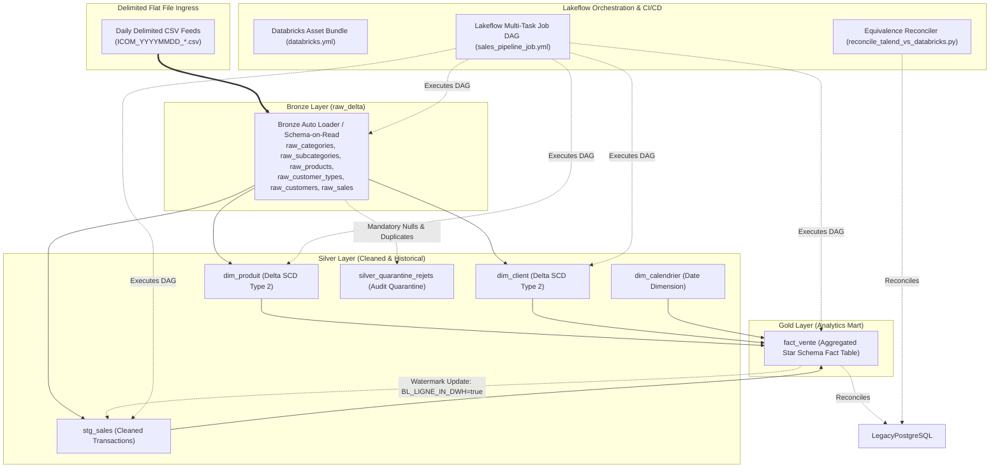

# Databricks Modernized Data Warehouse Alimentation Lakehouse

## System Architecture & Overview

This directory contains the complete modernized **Azure Databricks Medallion Lakehouse** platform replacing the legacy **Talend Open Studio ETL** data integration pipeline (`talend-project-big-data-master`).

The solution transforms 10 legacy Talend Open Studio jobs, 7 PostgreSQL Operational Data Store (`VENTE_ODS`) staging tables, and 4 Data Warehouse star schema (`VENTE_DWH`) tables into a cloud-native, configuration-driven PySpark pipeline governed by **Unity Catalog**, **Delta Lake**, and **Lakeflow Jobs**.



---

## Technical Mapping: Legacy Talend vs. Databricks Target

| Functional Subsystem | Legacy Talend Component / Job | Modernized Databricks Architecture | Primary Target File |
| :--- | :--- | :--- | :--- |
| **Pipeline Master** | `jAlimentationBDD_0.1` | `PipelineAuditTracker` & `pipeline_runner.py` | `src/pipeline_runner.py` |
| **ODS Ingestion Gate** | `jChargeODS_0.1` + `tFileList` | `validate_ingress_directory` (Fail-fast Exit 4) | `src/bronze/ingest_raw_feeds.py` |
| **DWH Orchestration** | `jChargeDWH_0.1` | Lakeflow Task Dependencies (`depends_on`) | `resources/jobs/sales_pipeline_job.yml` |
| **Entity Staging** | `jOdsCategorie`, `jOdsProduit`, etc. | Bronze PySpark CSV Extraction | `src/bronze/ingest_raw_feeds.py` |
| **Reject Quarantine** | `tFilterRow` + `tUniqRow` + `ODS_REJET` | `clean_and_quarantine_feed` -> `silver_quarantine_rejets` | `src/silver/clean_reference_data.py` |
| **Dimension SCD-2** | `jDwhProduit_0.1`, `jDwhClient_0.1` | Delta Lake `MERGE` (`is_active`, `dt_insertion`, `dt_mise_a_jour`) | `src/silver/scd2_dimension_merge.py` |
| **Date Dimension** | `jGenerateCalendar_0.2` + POI Excel | `build_calendar_dimension` + `FrenchHolidaysCalculator` | `src/silver/build_calendar_dimension.py` |
| **Sales Staging** | `jOdsVente_0.1` | `clean_sales_transactions` | `src/silver/clean_sales_transactions.py` |
| **Fact Aggregation** | `jDwhVente_0.1` + `tHashOutput` | PySpark Star Join & Aggregation | `src/gold/aggregate_sales_fact.py` |
| **Watermarking** | `BL_LIGNE_IN_DWH` in `ODS_VENTE` | Delta Lake `MERGE` update on `silver.stg_sales` | `src/gold/aggregate_sales_fact.py` |
| **Execution Logging** | `customCode.getFormattedTime` | `format_duration()` & `PipelineAuditTracker` | `src/common/audit.py` |
| **Configuration** | `PARAMS_LOG.CONTEXTE` | Externalized YAML (`pipeline_config.yaml`) | `config/pipeline_config.yaml` |

---

## Directory Structure

```text
databricks/
├── databricks.yml                           # Databricks Asset Bundle (DAB) deployment config
├── README.md                                # Modernized system operations guide (this file)
├── config/
│   ├── pipeline_config.yaml                 # Catalog, schema, volume, and file definitions
│   └── quality_rules.yaml                   # Expectation and quarantine thresholds
├── resources/
│   └── jobs/
│       └── sales_pipeline_job.yml           # Lakeflow Multi-task Job orchestration
├── src/
│   ├── __init__.py
│   ├── pipeline_runner.py                   # Single-entrypoint master pipeline runner
│   ├── common/
│   │   ├── __init__.py
│   │   ├── session.py                       # SparkSession and catalog resolution
│   │   ├── audit.py                         # Execution logging, duration, run stats
│   │   └── holidays.py                      # Public holiday algorithm and calendar utilities
│   ├── bronze/
│   │   ├── __init__.py
│   │   └── ingest_raw_feeds.py              # Ingests CSVs into Bronze Delta tables
│   ├── silver/
│   │   ├── __init__.py
│   │   ├── clean_reference_data.py          # Category, Subcategory, Product, Customer
│   │   ├── scd2_dimension_merge.py          # Reusable Delta Lake SCD-2 MERGE engine
│   │   ├── build_calendar_dimension.py      # Calendar dimension generation
│   │   └── clean_sales_transactions.py      # Sales validation and reject logging
│   └── gold/
│       ├── __init__.py
│       └── aggregate_sales_fact.py          # Gold star schema fact table builder
└── tests/
    ├── __init__.py
    ├── unit/
    │   └── test_transformations.py          # PySpark transformation unit tests
    └── equivalence/
        └── reconcile_talend_vs_databricks.py # Automated parallel-run reconciliation engine
```

---

## Deployment and Execution Guide

### 1. Local / Standalone Execution
Run the full pipeline using PySpark:
```bash
python -m databricks.src.pipeline_runner "csvFiles" "20250605"
```

### 2. Databricks Asset Bundle (DAB) Deployment
Validate and deploy the bundle to Azure Databricks workspace:
```bash
# Validate bundle configuration
databricks bundle validate -t dev

# Deploy to target workspace
databricks bundle deploy -t dev

# Run job remotely
databricks bundle run -t dev sales_pipeline_daily
```

### 3. Running Parallel-Run Equivalence Reconciliation
Execute automated reconciliation comparing PostgreSQL and Databricks output:
```bash
export PGHOST="localhost"
export PGPORT="5432"
export PGDATABASE="vente_db"
export PGUSER="postgres"
export PGPASSWORD="your_password"

python -m databricks.tests.equivalence.reconcile_talend_vs_databricks
```
