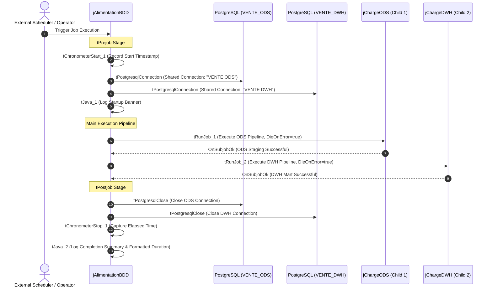

# Master Pipeline Orchestrator (jAlimentationBDD)

## Purpose and Scope

The `jAlimentationBDD` job (version `0.1`, item path `workspace://codebase/7c8eded6-9911-48de-929c-053e124fc8b5/file/ALIMENTATION_DATA_WAREHOUSE/process/Orechestration/jAlimentationBDD_0.1.item`) serves as the master execution harness for the complete warehouse alimentation cycle. It provides unified transaction scoping, execution timing, shared connection lifecycle management, and strict sequential ordering between raw staging (ODS) and analytical warehousing (DWH).

---

## Component Topology

| Component ID | Talend Component Type | Purpose & Configuration |
| :--- | :--- | :--- |
| `tPrejob_1` | `tPrejob` | Triggers pre-execution initialization hook |
| `tChronometerStart_1` | `tChronometerStart` | Captures job start epoch in `globalMap` under key `tChronometerStart_1_STARTTIME` |
| `tDBConnection_1` | `tPostgresqlConnection` | Opens shared connection `"VENTE ODS"`, `AUTO_COMMIT=false`, repository `_MQSMkD-pEfCJkrHegI1I0A` |
| `tDBConnection_2` | `tPostgresqlConnection` | Opens shared connection `"VENTE DWH"`, `AUTO_COMMIT=false`, repository `_FKqAwEHlEfCRobsmOeibog` |
| `tJava_1` | `tJava` | Emits job launch banner and human-readable start timestamp |
| `tRunJob_1` | `tRunJob` | Synchronously executes `jChargeODS`. `DIE_ON_CHILD_ERROR=true`, `TRANSMIT_WHOLE_CONTEXT=true` |
| `tRunJob_2` | `tRunJob` | Synchronously executes `jChargeDWH`. `DIE_ON_CHILD_ERROR=true`, `TRANSMIT_WHOLE_CONTEXT=true` |
| `tPostjob_1` | `tPostjob` | Triggers post-execution cleanup hook regardless of standard flow termination |
| `tDBClose_1` | `tPostgresqlClose` | Explicitly terminates connection `"VENTE ODS"` |
| `tDBClose_2` | `tPostgresqlClose` | Explicitly terminates connection `"VENTE DWH"` |
| `tChronometerStop_1` | `tChronometerStop` | Computes duration since beginning (`globalMap.get("tChronometerStop_1_DURATION")`) |
| `tJava_2` | `tJava` | Emits finish timestamp and formatted runtime using `customCode.getFormattedTime(...)` |

---

## Control Flow and Error Handling

1. **Failure Propagation:**
   - Both child jobs configure `DIE_ON_CHILD_ERROR = true`. If any component in `jChargeODS` fails (e.g. missing daily directory or schema violation), `jAlimentationBDD` terminates immediately with a non-zero exit code, preventing `jChargeDWH` from running on partial or corrupted staging data.
2. **Postjob Guarantees:**
   - The `tPostjob` sequence executes even on JVM shutdown signals or child errors, ensuring that database connection sockets are closed and resources freed.
3. **Implicit Context Loading:**
   - Inherits implicit database context loader reading table `PARAMS_LOG.CONTEXTE`. Values fetched override design-time defaults for `ServerName`, `database`, `port`, `utilisateur`, and `password`.

---

## Evidence Grounding

- Source definition: `workspace://codebase/7c8eded6-9911-48de-929c-053e124fc8b5/file/ALIMENTATION_DATA_WAREHOUSE/process/Orechestration/jAlimentationBDD_0.1.item`
- Context parameters: `workspace://codebase/7c8eded6-9911-48de-929c-053e124fc8b5/file/ALIMENTATION_DATA_WAREHOUSE/context/projectvariable_0.1.item`
- Formatting routine: `workspace://codebase/7c8eded6-9911-48de-929c-053e124fc8b5/file/customCode.java`
