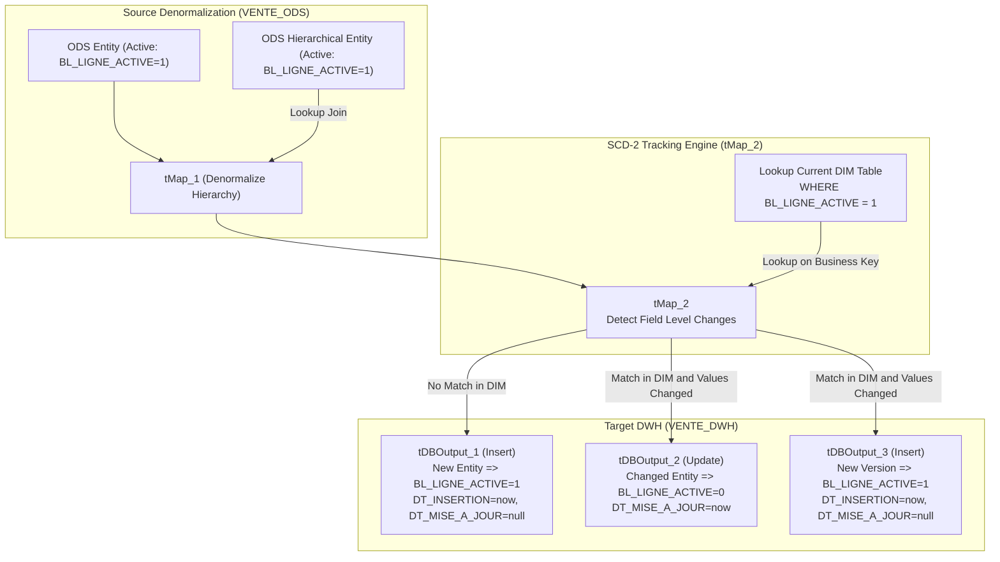

# DWH Dimension Loaders and SCD Type 2 Tracking (jDwhClient, jDwhProduit)

## Purpose and Scope

The jobs `jDwhClient` and `jDwhProduit` maintain conformed dimensional models in the `VENTE_DWH` schema:
- `jDwhClient` (`workspace://codebase/7c8eded6-9911-48de-929c-053e124fc8b5/file/ALIMENTATION_DATA_WAREHOUSE/process/DWH/jDwhClient_0.1.item`) populates `DIM_CLIENT`.
- `jDwhProduit` (`workspace://codebase/7c8eded6-9911-48de-929c-053e124fc8b5/file/ALIMENTATION_DATA_WAREHOUSE/process/DWH/jDwhProduit_0.1.item`) populates `DIM_PRODUIT`.

Both jobs implement **Slowly Changing Dimension Type 2 (SCD-2)** logic using Talend `tMap` comparison against active records in the destination warehouse tables.

---

## Product Dimension Loader (jDwhProduit)

### Denormalization Flow
- Primary stream: `ODS_PRODUIT` (`WHERE BL_LIGNE_ACTIVE = 1`).
- Lookup 1: `ODS_SOUS_CATEGORIE` (`WHERE BL_LIGNE_ACTIVE = 1`), joined on `CD_SOUS_CATEGORIE`.
- Lookup 2: `ODS_CATEGORIE` (`WHERE BL_LIGNE_ACTIVE = 1`), joined on `CD_CATEGORIE`.
- Produces a single flattened product object containing `CD_PRODUIT`, `NOM_PRODUIT`, purchase/sale price, `CD_SOUS_CATEGORIE`, `LB_SOUS_CATEGORIE`, `CD_CATEGORIE`, and `LB_CATEGORIE`.

### SCD-2 Comparison Attributes
The flattened stream is matched against `DIM_PRODUIT` on `CD_PRODUIT` (`WHERE BL_LIGNE_ACTIVE = 1`). A new version is triggered if any of the following change:
- `NOM_PRODUIT`
- `PRIX_ACHAT_PRODUIT`
- `PRIX_VENTE_PRODUIT`
- `CD_SOUS_CATEGORIE`
- `LB_SOUS_CATEGORIE`
- `CD_CATEGORIE`
- `LB_CATEGORIE`

Surrogate key `ID_DIM_PRODUIT` is auto-generated by PostgreSQL sequence `DIM_PRODUIT_ID_DIM_PRODUIT_seq`.

---

## Customer Dimension Loader (jDwhClient)

### Denormalization Flow
- Primary stream: `ODS_CLIENT` (`WHERE BL_LIGNE_ACTIVE = 1`).
- Lookup: `ODS_TYPE_CLIENT` (`WHERE BL_LIGNE_ACTIVE = 1`), joined on `CD_TYPE_CLIENT`.
- Enriches customer record with descriptive classification `LB_TYPE_CLIENT`.

### SCD-2 Comparison Attributes
The stream is matched against `DIM_CLIENT` on `ID_CLIENT` (`WHERE BL_LIGNE_ACTIVE = 1`). A change triggers versioning if:
- `NOM_CLIENT` or `PREN_CLIENT`
- `CD_POSTAL_CLIENT`, `VILLE_CLIENT`, `PAYS_CLIENT`, `REGION_CLIENT`
- `CD_TYPE_CLIENT` or `LB_TYPE_CLIENT`

Surrogate key `ID_DIM_CLIENT` is generated via sequence `DIM_CLIENT_ID_DIM_CLIENT_seq`.

---

## Evidence Grounding

- `jDwhProduit` item: `workspace://codebase/7c8eded6-9911-48de-929c-053e124fc8b5/file/ALIMENTATION_DATA_WAREHOUSE/process/DWH/jDwhProduit_0.1.item`
- `jDwhClient` item: `workspace://codebase/7c8eded6-9911-48de-929c-053e124fc8b5/file/ALIMENTATION_DATA_WAREHOUSE/process/DWH/jDwhClient_0.1.item`
- Target SQL schemas: `workspace://codebase/7c8eded6-9911-48de-929c-053e124fc8b5/file/scriptSQL_partie_2/2-script_create_table_dwh.sql`
