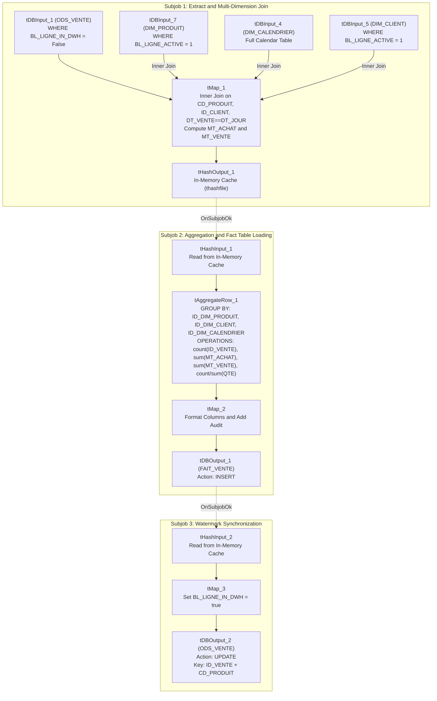

# DWH Fact Sales Mart Aggregator (jDwhVente)

## Purpose and Scope

The `jDwhVente` job (version `0.1`, item path `workspace://codebase/7c8eded6-9911-48de-929c-053e124fc8b5/file/ALIMENTATION_DATA_WAREHOUSE/process/DWH/jDwhVente_0.1.item`) is the central fact-loading engine of the warehouse. It extracts un-promoted transactional sales records from `VENTE_ODS.ODS_VENTE`, performs multi-dimensional inner lookups to conformed dimensions, computes financial metrics, aggregates transactions across common dimension keys, loads the summarized fact table `VENTE_DWH.FAIT_VENTE`, and updates the watermark flag in the ODS.

---

## Fact Metric Formulas

For each incoming sale row in `tMap_1`:
- **`MT_ACHAT`:** `row1.QTE_VENTE * row1.PRIX_ACHAT`
- **`MT_VENTE`:** `row1.QTE_VENTE * row1.PRIX_VENTE`

In `tAggregateRow_1`, transactions are grouped by the composite dimension surrogate key `(ID_DIM_PRODUIT, ID_DIM_CLIENT, ID_DIM_CALENDRIER)` and summarized:
- **`NB_VENTE`:** `count(ID_VENTE)` (total number of distinct line items)
- **`NB_QTE_VENTE`:** `count(ID_DIM_PRODUIT)` (total units sold across the grouping)
- **`NB_MT_ACHAT`:** `sum(MT_ACHAT)` (total purchase cost)
- **`NB_MT_VENTE`:** `sum(MT_VENTE)` (total gross sales revenue)

---

## Watermark Synchronization and Atomicity

1. **In-Memory Caching (`tHashOutput_1`):** To avoid re-querying the database or losing track of the exact set of processed records, joined records are retained in RAM.
2. **Post-Aggregation Watermarking:** Once `FAIT_VENTE` insertion succeeds (`OnSubjobOk`), `tHashInput_2` streams the original processed keys (`ID_VENTE`, `CD_PRODUIT`) into `tMap_3` where `BL_LIGNE_IN_DWH = true`.
3. **Database Commit Scoping:** In `tPostjob`, `tDBCommit_1` commits the DWH transaction and `tDBCommit_2` commits the ODS transaction, guaranteeing that records are never marked as processed in ODS if fact insertion fails.

---

## Evidence Grounding

- Job design: `workspace://codebase/7c8eded6-9911-48de-929c-053e124fc8b5/file/ALIMENTATION_DATA_WAREHOUSE/process/DWH/jDwhVente_0.1.item`
- Fact table DDL: `workspace://codebase/7c8eded6-9911-48de-929c-053e124fc8b5/file/scriptSQL_partie_2/2-script_create_table_dwh.sql`
