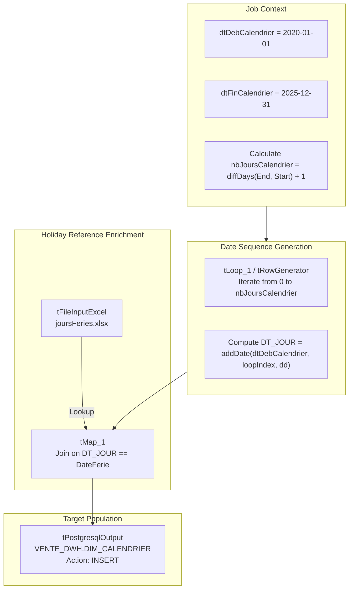

# Calendar Dimension Generator (jGenerateCalendar)

## Purpose and Scope

The `jGenerateCalendar` job (version `0.2`, item path `workspace://codebase/7c8eded6-9911-48de-929c-053e124fc8b5/file/ALIMENTATION_DATA_WAREHOUSE/process/DWH/jGenerateCalendar_0.2.item`) generates the enterprise conformed date dimension (`VENTE_DWH.DIM_CALENDRIER`). It builds a continuous chronological calendar spanning **2020-01-01** to **2025-12-31**, calculating calendar attributes, fiscal/quarter indicators, weekend flags, and joining with French national public holidays from an Excel spreadsheet (`joursFeries.xlsx`).

---

## Dimension Attribute Formulas

| Column Name | Data Type | Derivation Expression / Business Logic |
| :--- | :--- | :--- |
| `ID_DIM_CALENDRIER` | `INTEGER` | Surrogate key formatted as integer `YYYYMMDD` (e.g. `20250605`) derived via `TalendDate.formatDate("yyyyMMdd", DT_JOUR)` |
| `DT_JOUR` | `DATE` | Calendar day date (`yyyy-MM-dd`) |
| `NB_ANNEE` | `INTEGER` | Year number extracted from date (e.g. `2025`) |
| `NB_SEMESTRE` | `INTEGER` | Half-year: `month <= 6 ? 1 : 2` |
| `NB_TRIMESTRE` | `INTEGER` | Quarter: `(month - 1) / 3 + 1` (1 to 4) |
| `NB_MOIS` | `INTEGER` | Month number (1 to 12) |
| `NB_JOUR_ANNEE` | `INTEGER` | Day of the year (1 to 365/366) |
| `NB_JOUR_MOIS` | `INTEGER` | Day of the month (1 to 31) |
| `NB_JOUR_SEMAINE` | `INTEGER` | Day of week (1=Sunday or Monday depending on locale) |
| `NB_SEMAINE_ANNEE` | `INTEGER` | Week number of the year (1 to 52/53) |
| `LB_MOIS` | `VARCHAR(100)` | Full month name in French (e.g. "Janvier", "Février", ...) |
| `LB_JOUR` | `VARCHAR(100)` | Full day of week name in French (e.g. "Lundi", "Mardi", ...) |
| `BL_DERNIER_JOUR_MOIS` | `INTEGER` | `1` if date is the last day of the month; `0` otherwise |
| `BL_BISSEXTILE` | `INTEGER` | `1` if leap year (366 days); `0` otherwise |
| `BL_WEEK_END` | `INTEGER` | `1` if Saturday or Sunday; `0` otherwise |
| `BL_JOUR_FERIE` | `INTEGER` | `1` if match found in `joursFeries.xlsx`; `0` otherwise |
| `LB_JOUR_FERIE` | `VARCHAR(100)` | Public holiday name (e.g. "Jour de l'an", "Fête du Travail", "Noël") or `null` |

---

## Operational Execution Notes

- **Execution Cadence:** This job is a one-off / periodic dimensional initialization utility. It does not run in the daily `jChargeDWH` loop, but must be executed prior to any sales fact loading to ensure foreign key integrity (`FAIT_VENTE_CALENDRIER_FKEY`).
- **External Dependency:** Requires `joursFeries.xlsx` present in the working execution path.
- **Reference Archive:** Pre-packaged deployment archive available at `workspace://codebase/7c8eded6-9911-48de-929c-053e124fc8b5/file/jGenerateCalendar.zip`.

---

## Evidence Grounding

- Job item: `workspace://codebase/7c8eded6-9911-48de-929c-053e124fc8b5/file/ALIMENTATION_DATA_WAREHOUSE/process/DWH/jGenerateCalendar_0.2.item`
- SQL DDL: `workspace://codebase/7c8eded6-9911-48de-929c-053e124fc8b5/file/scriptSQL_partie_2/2-script_create_table_dwh.sql`
