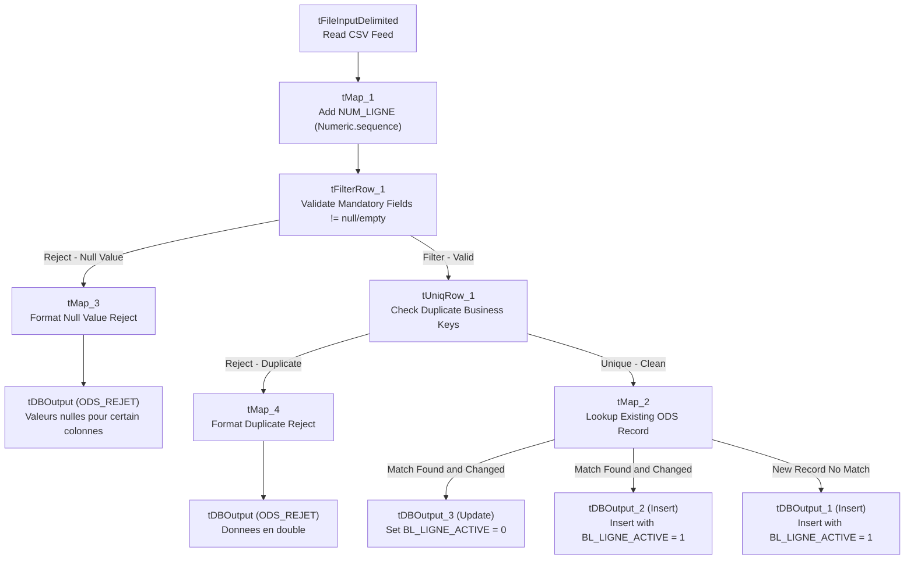

# ODS Entity Loaders (Categories, Sub-Categories, Products, Customer Types, Customers)

## Purpose and Scope

The ODS dimension loader jobs ingest reference entities from CSV files into the `VENTE_ODS` schema. Each job implements an identical robust architectural pattern:
- File detection via `tFileList` and global variable masking.
- Line numbering via `tMap_1` and sequence generators.
- Null validation via `tFilterRow_1`.
- Business key deduplication via `tUniqRow_1`.
- Reject logging into `ODS_REJET` for both null fields and duplicates.
- SCD Type 2 active versioning and history tracking in the ODS destination table.

---

## Job Specifications Summary

| Job Name | Source File Pattern | Business Key | Target Table | Null Validation Condition |
| :--- | :--- | :--- | :--- | :--- |
| `jOdsCategorie` | `ICOM_*_CATEGORY.csv` | `CD_CATEGORIE` | `ODS_CATEGORIE` | `!input_row.CD_CATEGORIE.isEmpty() && !input_row.LB_CATEGORIE.isEmpty()` |
| `jOdsSousCategorie` | `ICOM_*_SOUS_CATEGORIE.csv` | `CD_SOUS_CATEGORIE` | `ODS_SOUS_CATEGORIE` | `!input_row.CD_SOUS_CATEGORIE.isEmpty() && !input_row.LB_SOUS_CATEGORIE.isEmpty() && !input_row.CD_CATEGORIE.isEmpty()` |
| `jOdsProduit` | `ICOM_*_PRODUIT.csv` | `CD_PRODUIT` | `ODS_PRODUIT` | Keys not empty, purchase & sales prices parseable |
| `jOdsTypeClient` | `ICOM_*_TYPE_CLIENT.csv` | `CD_TYPE_CLIENT` | `ODS_TYPE_CLIENT` | `!input_row.CD_TYPE_CLIENT.isEmpty() && !input_row.LB_TYPE_CLIENT.isEmpty()` |
| `jOdsClient` | `ICOM_*_CUSTOMER.csv` | `ID_CLIENT` | `ODS_CLIENT` | ID, name, surname, city, country, region, and client type not empty |

---

## SCD Type 2 Implementation in ODS

In `tMap_2`, the incoming unique flow is joined against the existing ODS table (`tDBInput_1` with lookup query `SELECT * FROM "VENTE_ODS"."..."`).

1. **New Insert Flow (`insert...`):**
   - Condition: `lookup.BUSINESS_KEY == null`
   - Sets `DT_INSERTION = TalendDate.getCurrentDate()`, `BL_LIGNE_ACTIVE = 1`, `LB_JOB_NAME = jobName`, `LB_NOM_FICHIER = currentFile`.
2. **Historical Invalidation Flow (`UpdateBICurrent`):**
   - Condition: `lookup.BUSINESS_KEY != null && (!incoming.ATTR.equals(lookup.ATTR) || ...)`
   - Action: `UPDATE` target table matching on business key; sets `BL_LIGNE_ACTIVE = 0`.
3. **Current Version Insertion Flow (`insertNewCurrent`):**
   - Condition: Same change condition as above.
   - Action: `INSERT` new record with updated attributes, `DT_INSERTION = now()`, `BL_LIGNE_ACTIVE = 1`.

---

## Evidence Grounding

- Job items in repository:
  - `workspace://codebase/7c8eded6-9911-48de-929c-053e124fc8b5/file/ALIMENTATION_DATA_WAREHOUSE/process/ODS/jOdsCategorie_0.1.item`
  - `workspace://codebase/7c8eded6-9911-48de-929c-053e124fc8b5/file/ALIMENTATION_DATA_WAREHOUSE/process/ODS/jOdsSousCategorie_0.1.item`
  - `workspace://codebase/7c8eded6-9911-48de-929c-053e124fc8b5/file/ALIMENTATION_DATA_WAREHOUSE/process/ODS/jOdsProduit_0.1.item`
  - `workspace://codebase/7c8eded6-9911-48de-929c-053e124fc8b5/file/ALIMENTATION_DATA_WAREHOUSE/process/ODS/jOdsTypeClient_0.1.item`
  - `workspace://codebase/7c8eded6-9911-48de-929c-053e124fc8b5/file/ALIMENTATION_DATA_WAREHOUSE/process/ODS/jOdsClient_0.1.item`
