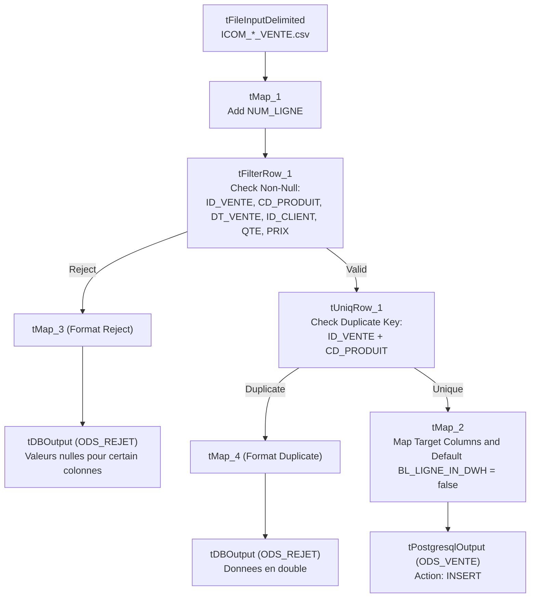

# ODS Sales Transaction Ingestion (jOdsVente)

## Purpose and Scope

The `jOdsVente` job (version `0.1`, item path `workspace://codebase/7c8eded6-9911-48de-929c-053e124fc8b5/file/ALIMENTATION_DATA_WAREHOUSE/process/ODS/jOdsVente_0.1.item`) ingests transactional sales data from daily files matching `ICOM_*_VENTE.csv` into `VENTE_ODS.ODS_VENTE`.

Unlike dimension loaders, sales transactions are factual ledger events rather than mutable master records. In addition to standard field validation and deduplication, `jOdsVente` initializes the warehouse synchronization watermark column `BL_LIGNE_IN_DWH = false`.

---

## Technical Transformation Details

1. **Input Schema:**
   - `ID_VENTE` (String)
   - `CD_PRODUIT` (String)
   - `DT_VENTE` (Date, pattern `"dd-MM-yyyy"`)
   - `ID_CLIENT` (String)
   - `QTE_VENTE` (Integer)
   - `PRIX_ACHAT` (Numeric / Double)
   - `PRIX_VENTE` (Numeric / Double)
2. **Key Uniqueness Rule:**
   - The composite primary key across the sales file is `ID_VENTE` + `CD_PRODUIT` (a transaction order line item). `tUniqRow_1` flags both columns as key attributes.
3. **Audit and Watermarking Attributes:**
   - `LB_NOM_FICHIER`: current file name from `((String)globalMap.get("tFileList_1_CURRENT_FILE"))`
   - `DT_INSERTION`: current execution timestamp (`TalendDate.getCurrentDate()`)
   - `LB_JOB_NAME`: execution job name (`jobName`)
   - `BL_LIGNE_IN_DWH`: initialized as boolean literal `false`. This flag indicates to the downstream DWH pipeline that this transaction line is pending ingestion into `FAIT_VENTE`.

---

## Evidence Grounding

- Item definition: `workspace://codebase/7c8eded6-9911-48de-929c-053e124fc8b5/file/ALIMENTATION_DATA_WAREHOUSE/process/ODS/jOdsVente_0.1.item`
- Physical DDL: `workspace://codebase/7c8eded6-9911-48de-929c-053e124fc8b5/file/scriptSQL_partie_1/2-script_create_table_ods.sql`
