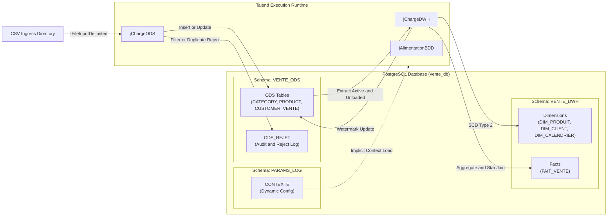

# Data Warehouse Alimentation System Architecture

## Architecture Overview

The **Talend Data Warehouse Alimentation** system processes raw business data through a structured three-tier enterprise data integration pipeline:

1. **Ingress Tier (File System / Staging):** Source systems deliver date-stamped CSV files into a directory hierarchy partitioned by execution date (`YYYYMMDD`). External holiday reference data is supplied via Excel (`joursFeries.xlsx`).
2. **Operational Data Store (ODS Tier):** Normalizes, deduplicates, and validates file contents. Enforces data quality by redirecting invalid or duplicate lines to `ODS_REJET`, tracks versioning using active-flag indicators (`BL_LIGNE_ACTIVE`), and flags transactions for warehouse promotion (`BL_LIGNE_IN_DWH`).
3. **Data Warehouse (DWH Tier):** Transforms normalized ODS structures into a star schema hosted in the `VENTE_DWH` schema. Maintains Type 2 Slowly Changing Dimensions (SCD-2) for Customer and Product entities, calculates business metrics, joins transactional sales with conformed time dimensions, and populates the summarized fact table `FAIT_VENTE`.

---

## Technical Stack and Components

| Technology Component | Version / Specification | Role in System |
| :--- | :--- | :--- |
| **ETL Engine** | Talend Open Studio for DI v8.0.1 | Visual design, code generation (Java 1.8/11), component orchestration |
| **Relational Database** | PostgreSQL 9.x / 12+ | Target operational and analytical database (`vente_db`) |
| **JDBC Driver** | `org.postgresql.Driver` (`postgresql-42.2.14.jar`) | Database connectivity across all connections |
| **Build & Packaging** | Apache Maven (`poms/pom.xml`) | Routine compilation, dependency resolution, standalone job exports |
| **In-Memory Cache** | Talend `tHashFile` (`thashfile-3.1-20190910.jar`) | In-memory record caching between fact table generation and watermark updates |
| **Custom Code** | Java 8 (`routines.customCode`) | Execution time formatting, operational logging utilities |
| **File Format** | Delimited text (`ISO-8859-15` / `UTF-8`, Pipe `\|` delimiter) | Ingress data contract for business feeds |
| **Office Automation** | Apache POI (`tFileInputExcel`) | Reference public holiday file extraction (`joursFeries.xlsx`) |

---

## Process Topology and Control Flow

The runtime orchestration follows a strict two-stage sequential workflow managed by `jAlimentationBDD`:

1. **Prejob Stage:**
   - Starts job execution stopwatch (`tChronometerStart`).
   - Initializes shared pooled connections to `VENTE_ODS` (`"VENTE ODS"`) and `VENTE_DWH` (`"VENTE DWH"`).
   - Dynamically loads configuration parameters from `PARAMS_LOG.CONTEXTE` via implicit context loading.
   - Outputs initialization banner with timestamp.
2. **ODS Extraction and Staging (`jChargeODS`):**
   - Validates that the current day's directory (`YYYYMMDD`) exists under the root path. Halts immediately with exit code `4` if absent.
   - Sequentially triggers subjobs: `jOdsCategorie` -> `jOdsSousCategorie` -> `jOdsProduit` -> `jOdsTypeClient` -> `jOdsClient` -> `jOdsVente`.
   - Each child process performs field null validation, duplicate detection, SCD versioning, and reject logging.
3. **DWH Star Schema Loading (`jChargeDWH`):**
   - Sequentially triggers dimension updates: `jDwhProduit` -> `jDwhClient`.
   - Executes fact table aggregation and loading: `jDwhVente`.
   - Updates watermark flag (`BL_LIGNE_IN_DWH = true`) in `ODS_VENTE` for processed records.
4. **Postjob Stage:**
   - Issues commits across open database transactions.
   - Closes connections gracefully.
   - Stops stopwatch and calculates total elapsed runtime using `customCode.getFormattedTime()`.

---

## Architectural Guardrails and Evidence Grounding

- **Transaction Integrity:** ODS and DWH database outputs run under explicit connection sharing with uncommitted transactions until subjobs settle and postjobs commit.
- **Watermarking:** Sales transactions in `ODS_VENTE` carry a boolean flag `BL_LIGNE_IN_DWH`. The DWH extractor exclusively queries rows where `BL_LIGNE_IN_DWH = false`.
- **SCD Type 2 Historization:** Dimension tables maintain active version flags (`BL_LIGNE_ACTIVE: 1=active, 0=historical`) and modification timestamps (`DT_MISE_A_JOUR`).
- **Codebase References:**
  - SQL Schema scripts: `workspace://codebase/7c8eded6-9911-48de-929c-053e124fc8b5/file/scriptSQL_partie_1/1-script_create_schema.sql`
  - Master Orchestration: `workspace://codebase/7c8eded6-9911-48de-929c-053e124fc8b5/file/ALIMENTATION_DATA_WAREHOUSE/process/Orechestration/jAlimentationBDD_0.1.item`
